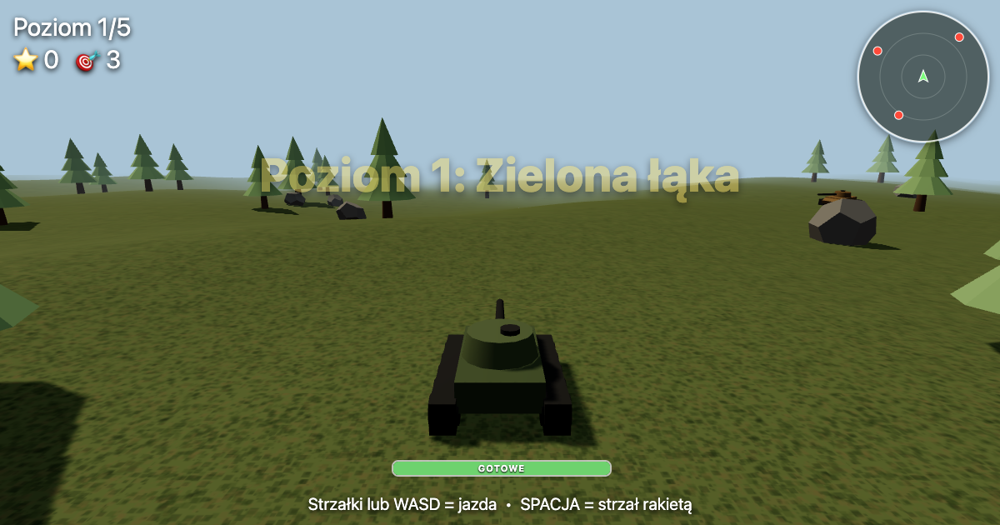

# Czołgi



Prosta gra 3D w przeglądarce: czołgi strzelają rakietami. Zrobiona tak, żeby ogarnął ją 6-latek.

- 5 poziomów (łąka, pustynia, śnieg, zmierzch, wielka bitwa)
- wzgórza, bezwładność, odrzut, wybuchy, padające drzewa
- minimapka z wrogami, pasek przeładowania, dźwięk silnika
- sterowanie: klawiatura (strzałki/WASD + spacja) albo dotyk (gałka + przycisk strzału)

## Uruchomienie

Wymaga internetu (three.js z CDN). Najlepiej przez lokalny serwer:

```bash
python3 -m http.server 8000
```

i otworzyć `http://localhost:8000`. Na iPadzie: adres IP komputera w tej samej sieci Wi-Fi.
